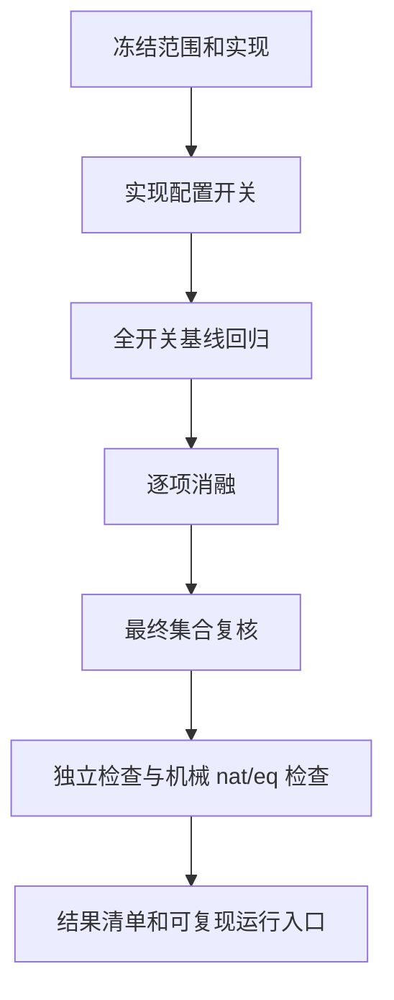

# Corelib 可执行规则集合

验收范围固定为 scope.json 的 67 个模块 / 2180 个去重根声明。
使用现有 Rocq 导出 IR；其源端 roundtrip 证据逐文件绑定。最终重新运行源端检查。
nat / eq 继续机械生成。定理仍为陈述，不允许引入新待证参数；不再使用的原参数仅在完整独立审计通过后允许消除，并逐项记录。
不删除检查、不缩小根集合、不把失败改记成功。

1. 冻结输入、基线实现和结果分类。
2. 独立 materialized translator 加入具名机制开关；所有开关启用时回归完整范围。
3. 从接受记录提出删减候选；关闭后实际翻译，不以“没记录”代替验证。
4. 逐项删减：全范围通过才接受删除；失败保存最先受影响的声明、错误与依赖。
5. 在最终集合上重查每一项保留的可选机制，排除因删减次序造成的假必要性。
6. 全量独立 Lean consumer、结构 audit、源 roundtrip、机械 nat/eq 及负例检查。
7. 发布可执行配置、补丁、结果、必要性见证和使用方式，同步 Git 与 Mac。

“不可再逐项删除”仅相对于本实验定义的机制粒度及固定实现、输入、检查条件。
这不是所有可能翻译算法中的全局最小规则数量证明。
固定的 AST / 声明翻译、依赖管理、原语语义映射、quality 分支和强制检查单列，
不能把可选机制数量冒充全部规则数量。
