# Correspondence depends on DAG

This is the mechanism dependency diagram of the plan; the arrows indicate that the former can support the latter, but do not indicate that these tasks have been completed.

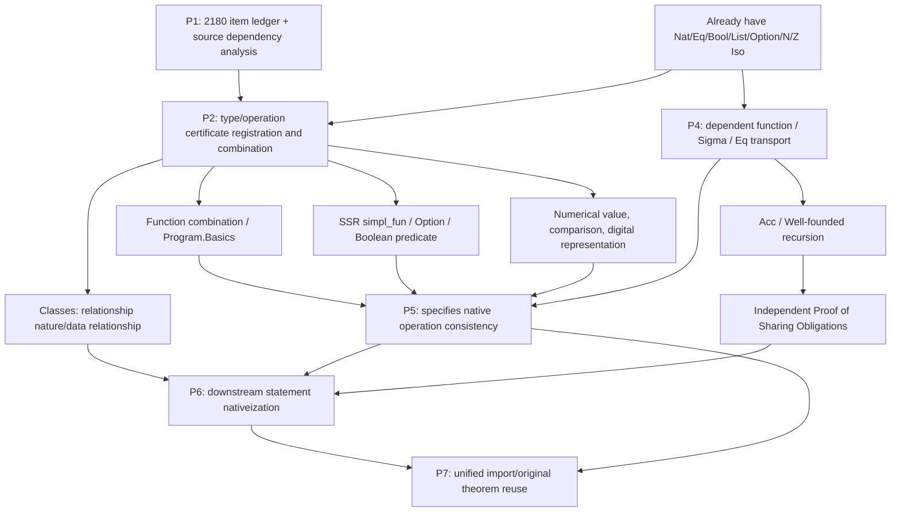

## The two dependencies cannot be confused

1. **Source Statement Dependency (Fact)**: From the deps field in full-v1/source.ndjson. Just because a source declaration refers to a type does not automatically mean that the type must first be proved to be Iso to the native object; sometimes this can be partially expanded or a relational proof can be used.
2. **Bridge task dependency (planning)**: For example, the container conversion of SSR Option.map uses Option Iso, and the element conversion may use Nat Iso; the operation combination uses function correspondence. They are the certificates required for the chosen scenario and do not impersonate the source IR side.

If the complete source graph contains self-recursion or mutual recursion, the strongly connected component (SCC) should be shrunk to obtain DAG. The edge direction is unified as "depending on the → user". Auxiliary declarations outside the diagram that are not included in this 2180 root are retained in the external dependency field and are not quietly discarded.

First batch:
- Option Iso → SSR Option.map/bind/default/apply/lift
- Function structure → Program.Basics, SSR comp/catcomp/idfun
- simpl_fun constructor → simpl_fun Iso → fun_of_simpl corresponding
- Nat Iso + recurser corresponds to → Nat.iter
- The above operation certificate → high-order/composite function automatic proof

These edges will be verified in actual proofs; there is currently no claim that the complete mathematical dependence has been discovered automatically.
<!-- generated -->

## Actual source dependency checks

Covering the 2180 root; dependent records of the 9457 stripe category; 2180 SCC, 7230 DAG edges after shrinkage. Passed topological sort check.

The dependent source is the deps field of IR. Both recursive components and external auxiliary dependencies are preserved; it cannot be directly inferred from these edges which Iso the corresponding proof must depend on.

| dependent root | Number of direct users |
|---|---:|
| Corelib.Init.Logic.eq | 588 |
| Corelib.Init.Datatypes.bool | 423 |
| Corelib.Relations.Relation_Definitions.relation | 181 |
| Corelib.Init.Datatypes.is_true | 165 |
| Corelib.Init.Datatypes.nat | 147 |
| Corelib.Numbers.Cyclic.Int63.PrimInt63.int | 123 |
| Corelib.Classes.CRelationClasses.crelation | 122 |
| Corelib.Numbers.BinNums.Z | 112 |
| Corelib.Init.Logic.iff | 107 |
| Corelib.Numbers.BinNums.positive | 99 |
| Corelib.ssr.ssrbool.predPredType | 92 |
| Corelib.Init.Datatypes.prod | 91 |
| Corelib.ssr.ssrbool.mem | 88 |
| Corelib.Init.Datatypes.negb | 87 |
| Corelib.Init.Logic.eq_rect | 86 |

## Bridging proof dependency and current round state

| Corresponding tasks | bridge/facilities used | Status |
|---|---|---|
| SSR Option Five operations | Already have optionTo/optionIso; element conversion combination Iso.functions / Iso.options | Five operations have been proved; the element conversion of map has an independent theorem |
| simpl_fun → function | Source constructor and fun_of_simpl; bidirectional inverse | Certified and connected to the new generator |
| simpl_fun Bool Bool native interface | simplFunIso → functions(boolIso, boolIso); type alias normalization | Automatic generation and round-trip pass, the additional certification result is f true |
| SSR Relationship nature | Mechanical Eq ↔ Lean Eq; Function epitaxy is used for eqfun/eqrel | Eight predicates correspond to proven |
| Nat.iter | natTo; source recurser; carrier Iso and step function corresponding hypothesis | Passed two certificates of ordinary and converted carriers |
| Compound Option / function expression | Option.map/bind corresponding + comp corresponding | The two examples automatically combine to pass; the target expression is still provided explicitly |
| Numbers represent further operations | uint ↔ List Fin; Nat arithmetic; symbol pair and base Sum | Read, compare, normalize proven; write to be continued |
| Dependency type/Acc | Acc conversion + recursive step correspondence + native good foundation | The term recursion/predicate of Acc and 7 has been proved; Sigma/Subtype has been advanced, the binary recursion has been proved, and the remaining conditions of Eq/ need to be continued. |

## Second batch: Certificate reuse to downstream statements

    Bool Iso + function Iso → pred/rel Iso
    Bool constructor + source logic negation → reflect Iso → Decidable P
    Eq Iso + Bool operation → SSR Boolean relational properties
    Bool quantifier/higher-order function/eliminator transformation + above certificate → 216 renormalization of statements
    Normalization + raw statements iff + recursively checking bridge aliases → 141 fully raw statements

75 candidates still have source symbols remaining, mainly involving mem_pred/mem, phantom, classically, some high-order functions and dependency Bool elimination; not counted as complete correspondence. See reports/statement-candidates.json for detailed records.

## Batch 3 and 4: Checked bridging dependencies

    uint ↔ List (Fin radix) → reverse/append/length/dropWhile/BEq
    digit representation + sign Bool → signed_int Iso → signed BEq / norm / abs / opp
    decimal/hex digits + Sum → Number.uint Iso
    digit representation + natTo + tail_mul agreement → of_uint/of_hex_uint foldl
    BEq correspondence + Eq conversion → 8 native statements ↔ source statements
    native LawfulBEq → native soundness/completeness → 8 original-statement proofs
    source Acc constructors ↔ Lean Acc → well_founded ↔ WellFounded
    Acc conversion + recursion induction → Fix_F / Fix / Acc recursors
    native InvImage.wf + natTo → source well-foundedness of a mechanical Nat measure

The next dependencies are still planning: Little.succ → digital writing; prodIso + Acc → binary base recursion; Sigma/Subtype + Eq transport → dependency function. Counterexample theorems or usage examples are not counted as additional Corelib roots.

## The fifth batch: complete Sort and condition proof DAG

    sig ↔ Subtype / sigT ↔ PSigma / prod ↔ PProd → depends on 8 of motive eliminator
    sigT2 ↔ PSigma(PProd) → projT3 / sigT_of_sigT2
    The projection of sig proves the closed instantiation of → sigT_of_sig
    The projection of sigT proves the closed instantiation of → sig_of_sigT
    The first projection of sig2 proves the closed instantiation of → sig_of_sig2
    Closed instantiation of sig_of_sig2 + two properties of sig2 → Two tasks of sigT2_of_sig2
    The above three proofs correspond to the closed instantiation of → sigT2_of_sig2 and the native construction of →

5 different witnesses and 4 source roots; the reuse of predecessor obligations does not mean automatically covering all downstream statements that depend on it.

## Batch 6: Actual results of dependency reuse

    prodIso + source Acc ↔ native Acc → pairAccTo/pairAccOf
    pair Acc + pull back of original relationship + dependent return family → Fix_F_2
    pair WellFounded + Fix_F_2 → well_founded_induction_type_2
    native sum measure + native recursion theorem → Mechanical binary countdown correctness
    Proven obligation of sig_of_sig2 Actual closed instantiation of the five downstream statements of →
    Subtype Iso + Eq + projection conversion → Five original iff → Five original statement certificates
    Type Iso + native dependency motive → 18 corresponds to basic rec/rect
    Complete Sort of sum ↔ PSum → sum_rec/sum_rect

The set of conditional dependencies is extracted from the original translation_report and checked item by item; the count is determined by checking the kernel after instantiation and the explicit certificate manifest.

## The seventh batch: Eq and Bool index propositions

    Mechanical forward and reverse correspondence of Eq ↔ Eq → Eq.ndrec
    Mechanical Eq Symmetry → eq_rec_r / eq_rect_r Obligation → Two closing operations
    eq_sym + Identity Obligation + Prove Irrelevance → eq_sym_involutive → eq_rew_r_dep
    Bool Iso + eq_true Constructor → eq_true ↔ (b = true) → Eight Eliminators
    Bool Bidirectional transfer of predicate + eq_true Iso → Three original statements iff → Original statement proof

These are the checked bridge-proof dependencies; the 9457 dependencies of source IR have not been modified.

## Batch 8 and 9: Proof of Relationship and Variable Parameters DAG

    Eq/And/Or/iff corresponds to → relationship property → Equivalence Iso → Setoid → Quotient.sound
    Class relationship conversion + overall function conversion → 65 statements automatically rewritten → 56 complete native iff
    Tlist ↔ List (Type u) → Arguments → arrows curry/uncurry Iso
    arrows Iso + PULift Prop conversion → native tuple predicate → 12 variable parameter operation
    Correspondence to variable parameter operation + original logical properties → The remaining 9 original statement proofs and original iff
    Native relation conversion + 3 axiom-free obligations → 2 conditional statement closure

The 126 root coverage of the two modules is checked by root-by-root ledger; this does not mean that other Classes modules have been completed.

## Batch 10: Maintaining relationship with Morphisms

    Relational bridging + native function quantifier → Proper / respectful / pointwise / forall relation
    Four empty tag constructors → True Iso
    The above certificate + compose/impl/pointwise overall function equation → 55 complete native statements
    Carrier Iso + Explicit operation correspondence + Native proof of maintaining relationship → Mechanical Proper

The auxiliary proof of repeated relationships is rechecked in the Morphisms export closure and is not repeatedly counted into the source root.

## Batch 11: Relationship package, Subtype and reachability

    Equivalence/PER evidence conversion → equiv/pequiv original relationship
    Subtype Iso + respectful → respecting function package → native composite example
    Subtype quantifier/projection transformation + relational property → 14 completely native statements
    Acc Iso + native logical global function equation → Morphisms_Prop of 17 native iff
    Equivalence Iso → Setoid_Theory → 5 iff certified with the original statement

## P7: Cross-closure consumption

    Checked profile certificate → dependency closure → namespace reconstruction → kernel recheck
    28 reconstruction modules → same file import → 585 entrance axiom audit
    Nat operation corresponding + SSR Option.map corresponding + Setoid Iso → native Quotient consumption
    Nat.add corresponds to → Mathlib Nat.prime_two → The native prime number property of the mechanical addition result

The coverage list for this joint import is independently fixed at reports/interop/coverage-manifest.json; subsequent new certificates must be subject to separate acceptance.

## Batch 12: Specif Statement

    Complete Sort's Subtype / PSigma Iso → two-way transfer of quantifiers and function families
    Eq correspondence + constructor/projection correspondence + logical existential quantifier → 49 candidate rewrite
    Native target recursive check + kernel iff → 49 complete native statements
    qualityProp → native existence quantifier; mechanical Eq proof quantifier → native Eq proof quantifier
    Clear proof of round trip/cast → isDefEq Cleanup → kernel Reinspection

All 49 unconditional candidates were approved; the conditional Specif declaration is still planned in the future.

## Batch 13: Writing numbers

    digits Iso → native increment → two kinds of Little.succ corresponding
    Nat Iso + increment → Two types to_little_uint corresponds to → reverse → to_uint
    increment value + Nat.rec → printed value is correct
    sign × digits + Sum Hexadecimal label → Number.signed_int Iso → Five types of label printing

Carry maintains canonicity + print value + Mathlib Nat.digits_ofDigits → Ready-made API correspondence for seven top-level prints. Both zero and endianness are explicitly adapted.

## Batch 14 and 15: Numerical Semantic Closure

    Native leading zero removal + zero value determination → Int value → three signed reads
    modulo corresponds to + natTo decrease amount → gcd terminates witness → Nat.gcd
    divmod invariant + first counter zeroing branch → full parameter native div/mod
    Native state iteration + square interval invariant → Nat.sqrt
    Native state iteration + quadratic power interval invariant → Nat.log2

These proofs are unmodified from the original mechanical translation.

Peano This batch of empirical evidence relies on: mechanical Nat Iso → pred/add/ iterator-assisted correspondence → 5 new completely native statements; IsSucc → native Nat positive. Old native target audit basis statement ledger → Actual Auto profile → The target body after the alias is expanded will not be replaced by the handwritten name profile.

The seventeenth batch of empirical dependencies: List Iso → Arbitrary comparator adaptation → List.compareLex; List family quantifier conversion → Forall Inductive statement. positive Numeric conversion → compare_cont → Pos.compare → N.compare / Z.compare → Size relationship, Boolean comparison, min/max. The carry/precursor assist of positive corresponds to → doubling, halving and boundary adaptation.

The eighteenth batch of empirical dependencies: positive Iso → mask/Option Nat Iso → multiplication mask → sub_mask/sub_mask_carry joint invariant → Pos.sub, N.sub; Z.double/succ_double/pred_double → Z.pos_sub → Z.add (also depends on Pos.add) → Z.sub. mask Iso → motive/ quantifier conversion → 2 pure native inductive statements.

The nineteenth batch of empirical dependencies: complete Sort container Iso → quantifier/function family transformation → container induction statement; Bool/Ordering index Iso + PLift fiber per index Iso → dependent function family transformation → CompareSpecT/reflect summary statement; CompareSpec iff → 3 closed witness → CompareSpec2Type/CompSpec2Type. Eq transport + PProd maps → rew_pair.

## Batch 20: Init.Logic shared certification and nativeization

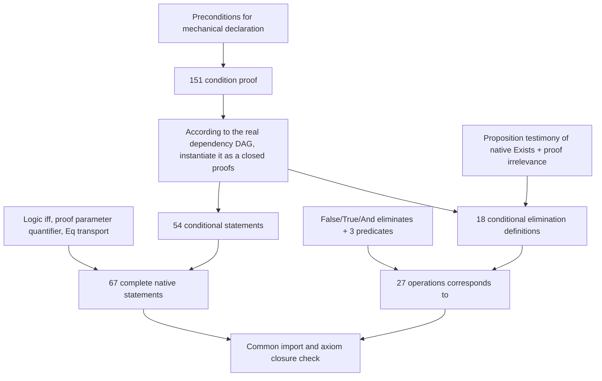

Real proof nodes and edges see reports/logic-witness-dag.json; each edge comes from frozen translation report pending_hypotheses. The 151 proof nodes of this graph are not the 151 new completion roots.

## Batch 21: Init.Specif dependent data and equality

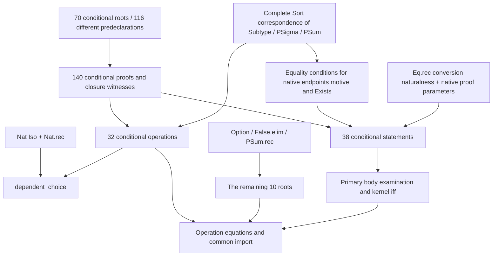

Node-by-node dependencies are from reports/specif-witness-dag.json, checked against freeze report pending_hypotheses; dependencies are not guessed based on rule names. 140 proof targets are not repeatedly counted as corresponding roots.

## Batch 22: SSR function, predicate and container statements

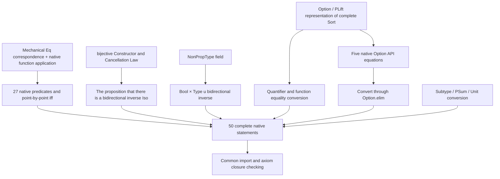

This batch does not add independent proofs of original theorem; only the corresponding certificates are registered. The corresponding relationship is reused until the source root is not repeated.

## Batch 23: Data interfaces and opaque computing gaps

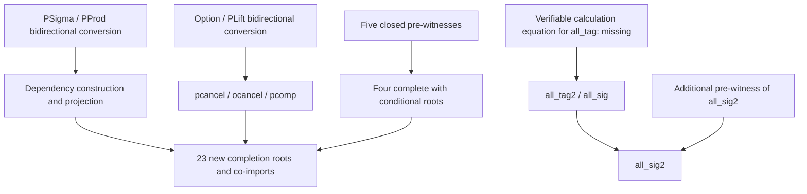

The existence of an opaque function for body does not provide a statement of equality with body. The rfl rejection and actual preconditions of synchronized kernel can be found in the reports/ssrfun-opacity.json and frozen translation reports respectively; these four items are not added to the completion number.

## Batch 24: Predicate packaging supports statement nativeization

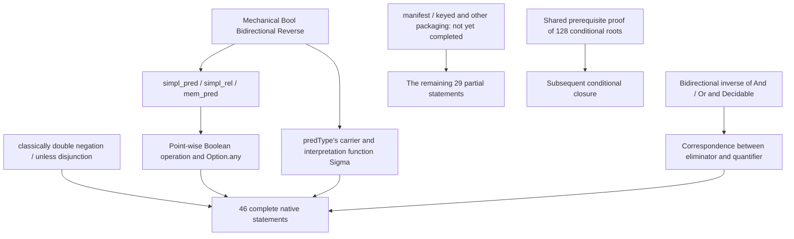

This batch of 46 statements iff does not increase the number of original theorem proofs. The remaining symbols are stored item by item in reports/ssrbool-extended-statement-candidates.json.

## Batch 25: Single value packaging of fixed parameters

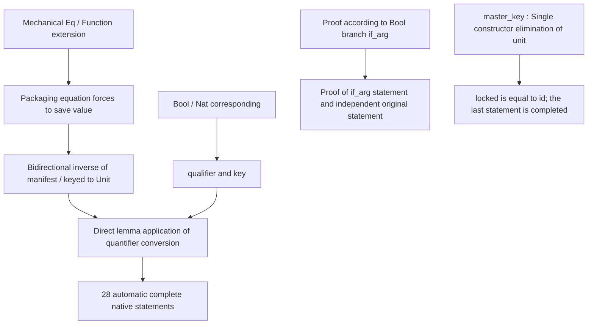

Unit only represents the wrapper after the fixed external predicate/qualifier parameter; the external parameters are not erased. Each quantifier substitution carries a kernel checkable proof of iff/propext.

## Batch 26: SSR Bool Conditions and Correspondence

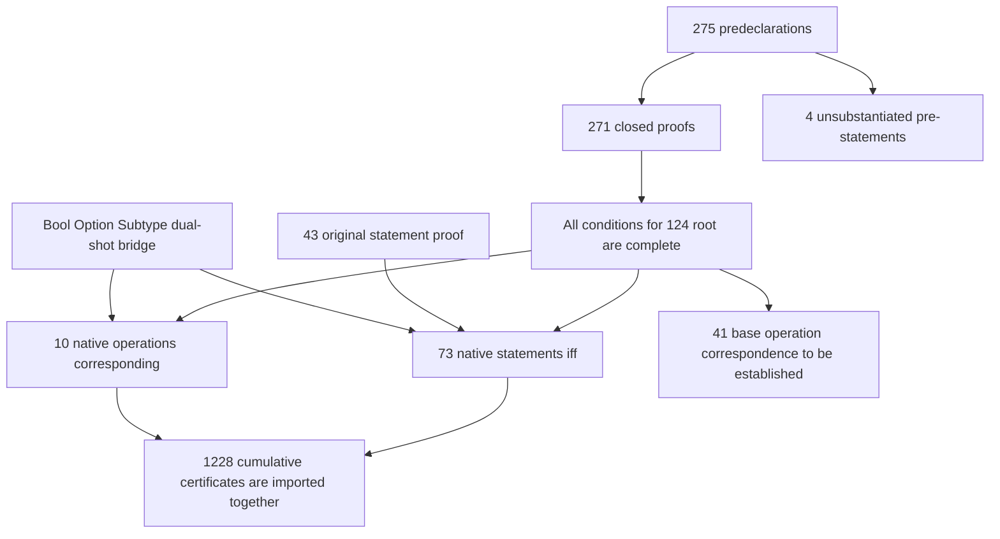

See reports/ssrbool-condition-dag.json for precise dependencies and root-by-root status. 314 proofs = 271 prestatements + 43 new original statements; the number of proofs is not regarded as the number of new corresponding roots.

## Batch 27: Separation of proof results and calculation results

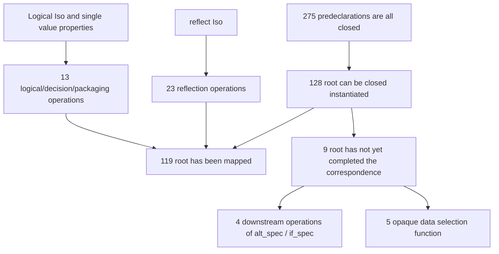

The existing machine opacity is retained. The proof object can be used to prove irrelevance; arbitrary data selection functions do not assume that the calculation results are equal.


## Twenty-eighth to thirty-first batch: New certificate dependencies in this round

The following is the proof task dependency; for the complete source code declaration dependency, see dependency-graph.json.

```mermaid
graph TD
  A[Bool / Eq / reflect existing Iso] --> B[alt_spec / if_spec bidirectional reverse]
  W[Existing 275 SSR pre-proofs] --> C[altP boolP ifP ifPn closed instance]
  B --> C
  M[memIso / sumboolIso] --> D[Restricted domain predicates and container branches]
  I[Pos.iter structure recursion] --> J[Nat.rec iteration correspondence]
  J --> K[integer power and signed shift]
  L [Multiplication / div2 corresponding] --> K
  S[12 pre-proofs of Sumbool] --> T[6 operations correspond to 1 statements]
  R[Type value relationship function and Prod / Sum] --> E[18 type bidirectional inverse]
  E --> F[20 projections and combination operations]
  C --> P[1336 coverage certificates are imported together]
  D --> P
  K --> P
  T --> P
  F --> P
```

The next layer reuses E/F to process the remaining statements of CRelationClasses; the opaque output carrying data requires independent calculation of evidence and cannot be applied only to prove the irrelevance of the object.

## Batch 32

The anti-reflexivity of CRelationData corresponds to the type of Iso → StrictOrder Iso → StrictOrder_Transitive; the same batch of reused relational data represents and proves 15 native statements iff, and the original statement proof is given. A total of 1353 coverage certificates have been imported together.

## Batch 33: Verified reuse relationships

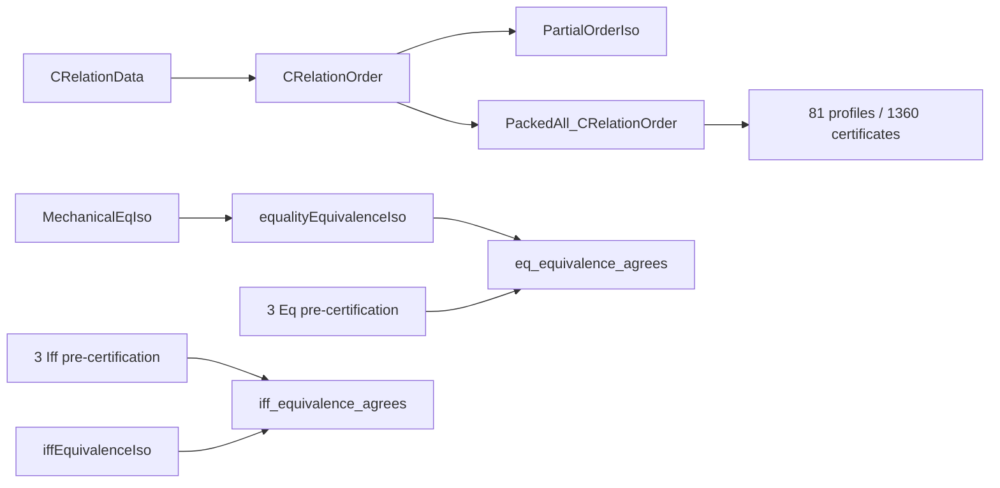

The last two equivalence relationships in the figure correspond to bidirectional inverses, and the six prerequisite proofs are closed; the complete Lean dependency is still recorded by the audit. Type value partial order only corresponds to function/product type representation.

## Batch 34 to 36: Checked certified dependencies

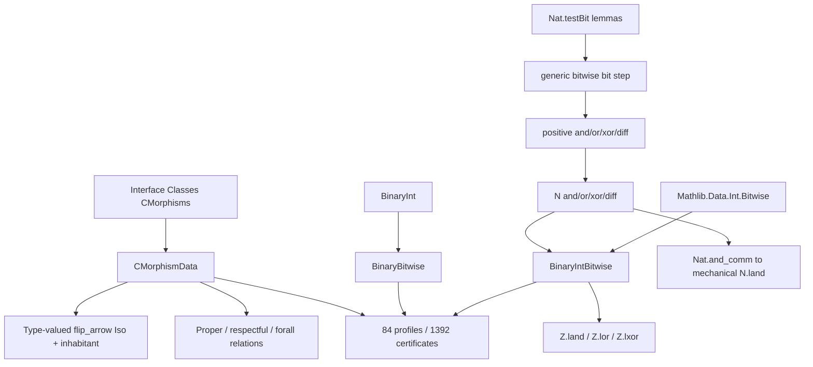

The subgoals for bitwise operations have been proven. The last three Lean import edges of profile are recorded by verify.py, and the remaining edges in the graph represent the actually used theorem dependencies. The math library code inherits from the installed version, and the fingerprint is in the verification record.

## Batch 37 to 39: Binary Division/Square Root/Iteration

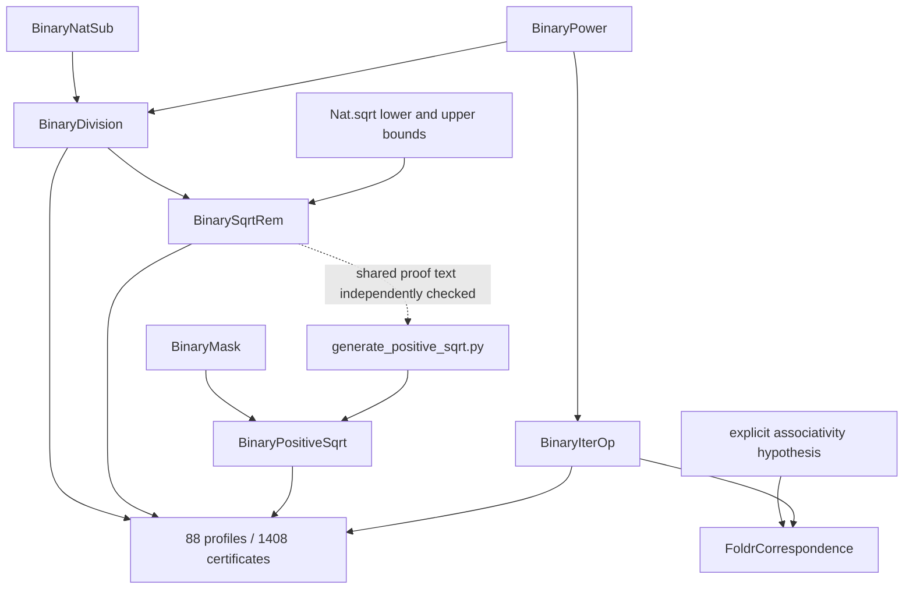

The source closures of IntDef and PosDef are verified separately and imported into namespace packaging in a unified manner. The next dependency node is Numbers.BinNums eliminator: positive/N/Z type Iso → native dependency recursive target → calculation corresponding to → native inductive statement.

## Batch 40 to 43: Data representation and closed equality determination

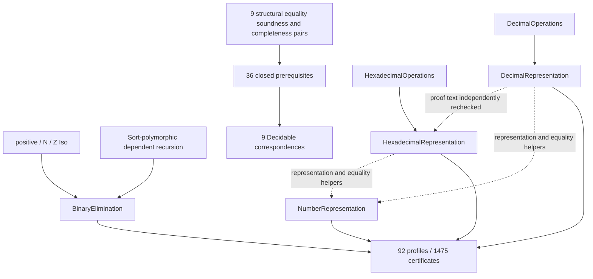

The dotted line indicates that the proof text is reused during code generation, and the actual source module closures are verified separately; it does not mean that different Rocq2LeanOut modules are directly imported. Bit order and complete representation preservation are the basis for the next batch of Byte.

## Batch 44 to 48 and the next dependency

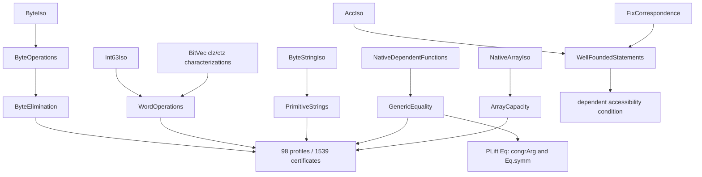

Byte string comparison is currently a native combination expression and is not claimed to correspond to ready-made List.compareLex. The generic J interface retains explicit relationship parameters; PLift Eq is just an authenticated client instance.

## Batch and machine integer specifications from 49th to 54th

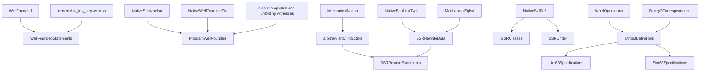

The two Type values of Program.Wf, the opaque eliminator, and the three Type values of ssreflect_rw, the opaque calculation function, still require additional computational evidence. They do not prevent transparent integer definitions and specification correspondence from moving forward.

## Batch 55 to 56: Bit operations and integer conversion

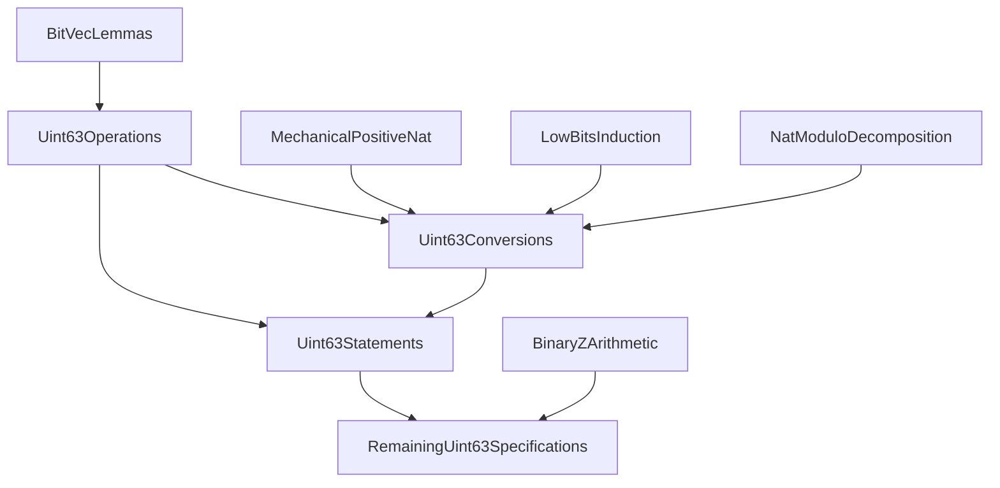

Uint63Operations and Uint63Conversions have been verified; Uint63Statements is the next batch. Old proofs of cross-source closures are rechecked after textual reuse without directly mixing different Rocq2LeanOut.

## Batch 57 to 59 and arithmetic specifications

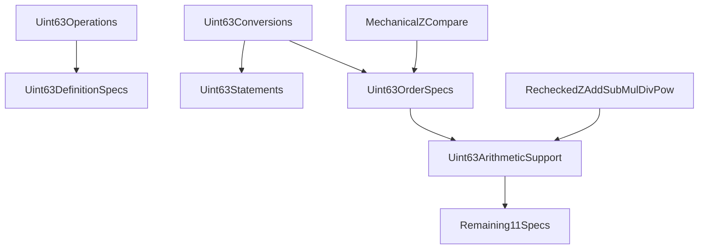

The first three specifications profile have been verified, arithmetic support and the remaining 11 items are still in progress.

## Sixtieth to sixty-second batch and wide operations

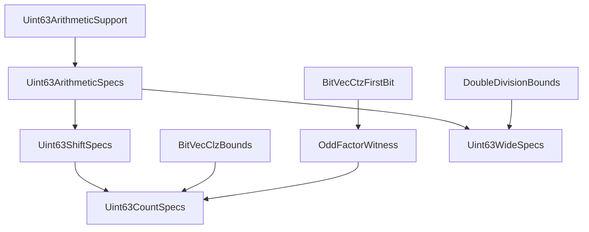

Arithmetic, shifting, counting profile passed audit. The snapshot time width calculation is still in progress; the sixty-third batch has been completed and included.

## Batch 63 to 65 and container specifications

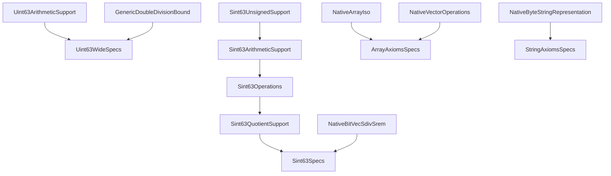

Integer nodes have been verified; container specification nodes were completed in batches 66 to 70. Declarations with the same name in closures from different sources are used through rechecking and are not mixed directly.

## Batch 66 to 70: Container dependencies verified

```mermaid
flowchart TD
  ArrayIso[bounded array and default value] --> ArraySpecs
  VectorGetSet[Vector read and update] --> ArraySpecs
  StringUnsignedSupport --> StringOperations
  NatZConversions[This closure Nat/Z conversion recheck] --> StringOperations
  StringOperations --> StringSpecs
  StringSpecs --> StringRoundtrip
  StringRoundtrip --> StringComparison
  ListCompareLex[Lean List.compareLex] --> StringComparison
  StringComparison --> PrimitiveCompare[PrimString.compare ready API certificate]
```

The above nodes have all been checked and co-imported. StringRoundtrip first proves the list view injection, and then proves the construction and reading round trip; StringComparison summarizes by comparing the remaining length, and handles equal prefixes and empty strings.

## Batch 71 to 75: Floating point dependency verified

```mermaid
flowchart TD
  NativeIntPositive [Mechanical Z/positive corresponding] --> SpecFloatRepresentation
  SpecFloatRepresentation --> SpecFloatArithmeticSupport
  SpecFloatArithmeticSupport --> SpecFloatRounding
  SpecFloatRounding --> SpecFloatShift
  SpecFloatShift --> SpecFloatNormalize
  SpecFloatNormalize --> FloatArithmeticNext[Subsequent addition, subtraction, multiplication, division and square root]
  SpecFloatRepresentation --> FloatPrimitiveNext[followed by PrimFloat]
```

The first five nodes have been completed and the last two nodes are pending. The half-unit branch of nearest-even and the rounding toward zero of shr_1 are both explicitly preserved. Basic markup proofs are independent modules and do not rely on floating point chains.

## Batch 76 to 81: Floating point operation dependency has been completed

```mermaid
flowchart TD
  SpecFloatNormalize --> SpecFloatComparison
  SpecFloatNormalize --> SpecFloatArithmetic
  SpecFloatNormalize --> SpecFloatMaskSupport
  SpecFloatMaskSupport --> SpecFloatExponent
  SpecFloatExponent --> SpecFloatAdjacent
  SpecFloatArithmetic --> SpecFloatAdjacent
  SpecFloatNormalize --> SpecFloatDivisionSupport
  SpecFloatDivisionSupport --> SpecFloatDivision
  SpecFloatArithmetic --> SpecFloatDivision
  SpecFloatDivision --> SpecFloatSqrtSupport
  NatSqrt[Lean Nat.sqrt and remainder uniqueness] --> SpecFloatSqrtSupport
  SpecFloatSqrtSupport --> SpecFloatSqrt
```

All nodes in this graph have been verified. The floating-point arithmetic backlog of the previous section is completed; processing of the PrimFloat representation and its conversion to SpecFloat continues.

## Batch 82 to 85: Specification binary64 dependency has been completed

```mermaid
flowchart TD
  NativeFields[Option Sum Bool Fin BitVec] --> PrimFloatRepresentation
  PrimFloatRepresentation --> PrimFloatArithmetic
  PrimFloatArithmetic --> PrimFloatExponent
  PrimFloatArithmetic --> PrimFloatSqrt
  NatSqrt[Lean Nat.sqrt] --> IntegerSqrtProof[Square bounds and uniqueness of bit-by-bit algorithm]
  IntegerSqrtProof --> PrimFloatSqrt
  PrimFloatExponent --> FloatOpsNext[To be completed FloatOps]
  SpecFloatShift --> FloatOpsNext
```

All nodes of PrimFloat have been verified; these proofs will be rechecked in the next phase by unifying the FloatAxioms source closure. parser, wrapper, eliminators, etc. that are not exported by the source closure do not need to be imported into the next stage support files.

## Batch 86 to 89: Conversion and specification dependencies completed

```mermaid
flowchart TD
  Symbolic[SpecFloat proven chain] --> FloatClosureSupport
  Primitive[PrimFloat proven chain] --> FloatClosureSupport
  FloatClosureSupport --> FloatWordSupport
  FloatWordSupport --> FloatOperations
  FloatOperations --> Float64Operations
  Float64Operations --> FloatStatements
  FloatOpsClosure[FloatOps independent source closure] --> FloatUlpSupport
  FloatUlpSupport --> FloatUlp
```

All nodes passed. The edges of FloatStatements represent the correspondences of operations required to combine statements for equivalence, and do not represent that these specifications have been independently proven to be true.

## The 90th batch and calculation transparent branch

~~~mermaid
flowchart TD
 SSRBoolPackaging --> SSRPredicatePackages
 SSRPredicatePackages --> Frozen2100[original baseline 2100/2180]
 Retained[opaque body with original baseline retained] --> TransparentPack
 TransparentPack --> CRelationVariant[CRelation 11 corresponding]
 TransparentPack --> CMorphismVariant[CMorphism 54 corresponding]
 CRelationVariant --> VariantAudit[Variation independent audit and joint import]
 CMorphismVariant --> VariantAudit
 TransparentPack --> SSRVariant[SSR 13 corresponding]
 TransparentPack --> ProgramWfVariant[Program.Wf 2 corresponding]
 SSRVariant --> VariantAudit
 ProgramWfVariant --> VariantAudit
 VariantAudit --> Variant80[remaining candidates 80/80]
 Frozen2100 --> Recheck[2100 root / 173 profile return passed]
 Variant80 --> Combined[2180 root complete variant co-import passed]
 Recheck --> Combined
~~~

Transparent branches do not write back the original statement and are not counted in Frozen2100. See [Variant result ](transparent-data/README.md) for details.
