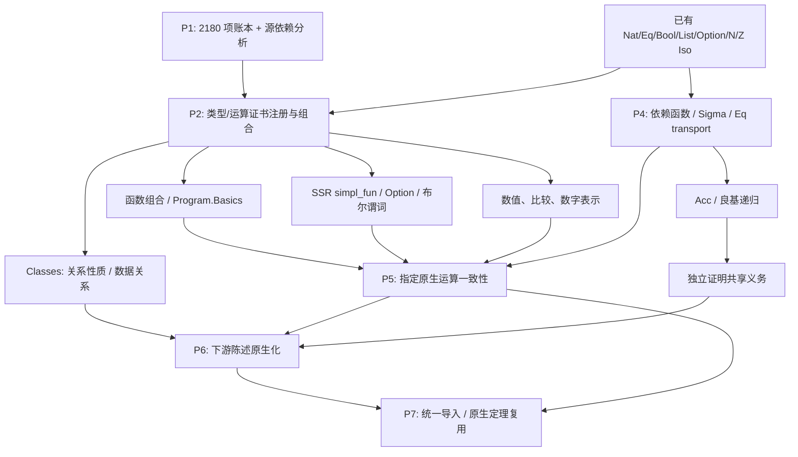

# Correspondence 依赖 DAG

这是计划的机制依赖图；箭头表示前者可支持后者，不表示这些任务都已完成。

## 两种依赖不能混淆

1. **源声明依赖（事实）**：来自 full-v1/source.ndjson 中的 deps 字段。源声明引用某类型，并不自动意味着必须先证明该类型与原生对象的 Iso；有时可以局部展开或使用关系证明。
2. **桥接任务依赖（规划）**：例如 SSR Option.map 的容器转换用 Option Iso，元素转换可能再用 Nat Iso；运算组合使用函数 correspondence。它们是所选方案需要的证书，不冒充源 IR 边。

完整源图若含自递归或互递归，应收缩强连通分量（SCC）后得到 DAG。边方向统一为“依赖 → 使用者”。图外未被这 2180 根收录的辅助声明保留在外部依赖字段，不悄悄丢弃。

首批：
- Option Iso → SSR Option.map/bind/default/apply/lift
- 函数结构 → Program.Basics、SSR comp/catcomp/idfun
- simpl_fun 构造器 → simpl_fun Iso → fun_of_simpl 对应
- Nat Iso + 递归器对应 → Nat.iter
- 上述运算证书 → 高阶/复合函数自动证明

这些边将在实际证明中验证；当前不声称完整数学依赖已自动发现。
<!-- generated -->

## 实际源依赖检查

覆盖 2180 根；9457 条带类别的依赖记录；收缩后 2180 个 SCC、7230 条 DAG 边。已通过拓扑排序检查。

依赖源为 IR 的 deps 字段。递归分量和外部辅助依赖均保留；不能由这些边直接推断对应证明一定依赖哪些 Iso。

| 被依赖根 | 直接使用者数 |
|---|---:|
| Corelib.Init.Logic.eq | 588 |
| Corelib.Init.Datatypes.bool | 423 |
| Corelib.Relations.Relation_Definitions.relation | 181 |
| Corelib.Init.Datatypes.is_true | 165 |
| Corelib.Init.Datatypes.nat | 147 |
| Corelib.Numbers.Cyclic.Int63.PrimInt63.int | 123 |
| Corelib.Classes.CRelationClasses.crelation | 122 |
| Corelib.Numbers.BinNums.Z | 112 |
| Corelib.Init.Logic.iff | 107 |
| Corelib.Numbers.BinNums.positive | 99 |
| Corelib.ssr.ssrbool.predPredType | 92 |
| Corelib.Init.Datatypes.prod | 91 |
| Corelib.ssr.ssrbool.mem | 88 |
| Corelib.Init.Datatypes.negb | 87 |
| Corelib.Init.Logic.eq_rect | 86 |

## 桥接证明依赖与本轮状态

| 对应任务 | 使用的桥接/设施 | 状态 |
|---|---|---|
| SSR Option 五项操作 | 已有 optionTo/optionIso；元素转换组合 Iso.functions / Iso.options | 五项运算已证；map 的元素转换有独立定理 |
| simpl_fun → 函数 | 源构造器与 fun_of_simpl；双向逆 | 已证，已接入新生成器 |
| simpl_fun Bool Bool 原生接口 | simplFunIso → functions(boolIso, boolIso)；类型别名正规化 | 自动生成与往返通过，另证结果为 f true |
| SSR 关系性质 | 机械 Eq ↔ Lean Eq；函数外延性用于 eqfun/eqrel | 八项谓词对应已证 |
| Nat.iter | natTo；源递归器；载体 Iso 与步函数对应假设 | 普通与转换载体两份证明通过 |
| 复合 Option / 函数表达式 | Option.map/bind 对应 + comp 对应 | 两例自动组合通过；目标表达式仍显式提供 |
| 数字表示进一步运算 | uint ↔ List Fin；Nat 算术；符号 pair 与进制 Sum | 读取、比较、规范化已证；写出待继续 |
| 依赖类型/Acc | Acc 转换 + 递归步骤对应 + 原生良基性 | Acc 与 7 项递归/谓词已证；Sigma/Subtype 已推进，二元递归已证，Eq/剩余条件待继续 |

## 第二批：证书复用到下游陈述

    Bool Iso + 函数 Iso → pred/rel Iso
    Bool 构造器 + 源逻辑否定 → reflect Iso → Decidable P
    Eq Iso + Bool 运算 → SSR 布尔关系性质
    Bool 量词/高阶函数/消去器转换 + 上述证书 → 216 个陈述的重新规范化
    规范化 + 原陈述 iff + 递归检查桥接别名 → 141 个完全原生陈述

75 个候选仍残留源符号，主要涉及 mem_pred/mem、phantom、classically、部分高阶函数及依赖 Bool 消去；未计作完全对应。详细记录见 reports/statement-candidates.json。

## 第三、四批：已检查的桥接依赖

    uint ↔ List (Fin radix) → reverse/append/length/dropWhile/BEq
    digit representation + sign Bool → signed_int Iso → signed BEq / norm / abs / opp
    decimal/hex digits + Sum → Number.uint Iso
    digit representation + natTo + tail_mul agreement → of_uint/of_hex_uint foldl
    BEq correspondence + Eq conversion → 8 native statements ↔ source statements
    native LawfulBEq → native soundness/completeness → 8 original-statement proofs
    source Acc constructors ↔ Lean Acc → well_founded ↔ WellFounded
    Acc conversion + recursion induction → Fix_F / Fix / Acc recursors
    native InvImage.wf + natTo → source well-foundedness of a mechanical Nat measure

接下来的依赖仍是规划：Little.succ → 数字写出；prodIso + Acc → 二元良基递归；Sigma/Subtype + Eq transport → 依赖函数。没有将反例定理或使用示例计成额外 Corelib 根。

## 第五批：完整 Sort 与条件证明 DAG

    sig ↔ Subtype / sigT ↔ PSigma / prod ↔ PProd → 依赖 motive 的 8 个消去器
    sigT2 ↔ PSigma(PProd) → projT3 / sigT_of_sigT2
    sig 的投影证明 → sigT_of_sig 的闭合实例化
    sigT 的投影证明 → sig_of_sigT 的闭合实例化
    sig2 的第一投影证明 → sig_of_sig2 的闭合实例化
    sig_of_sig2 的闭合实例化 + sig2 的两个属性 → sigT2_of_sig2 的两份义务
    上述三份证明 → sigT2_of_sig2 的闭合实例化 → 原生构造对应

5 个不同见证、4 个源根；前驱义务复用不等于自动覆盖所有依赖它的下游声明。

## 第六批：依赖复用的实际结果

    prodIso + source Acc ↔ native Acc → pairAccTo/pairAccOf
    pair Acc + 原生关系的拉回 + 依赖返回族 → Fix_F_2
    pair WellFounded + Fix_F_2 → well_founded_induction_type_2
    native sum measure + native recursion theorem → 机械二元倒计数正确性
    sig_of_sig2 的已证义务 → 五个下游陈述的实际闭合实例化
    Subtype Iso + Eq + 投影转换 → 五个原生 iff → 五个原陈述证明
    类型 Iso + 原生依赖 motive → 18 个基本 rec/rect 对应
    完整 Sort 的 sum ↔ PSum → sum_rec/sum_rect

条件依赖集合从原始 translation_report 抽取并逐项核对；计数由实例化后的 kernel 检查和显式证书清单决定。

## 第七批：Eq 与 Bool 索引命题

    机械 Eq ↔ Eq → Eq.ndrec 的正向与反向对应
    机械 Eq 对称性 → eq_rec_r / eq_rect_r 义务 → 两个闭合运算
    eq_sym + 恒等义务 + 证明无关性 → eq_sym_involutive → eq_rew_r_dep
    Bool Iso + eq_true 构造器 → eq_true ↔ (b = true) → 八个消去器
    Bool 谓词的双向搬运 + eq_true Iso → 三个原生陈述 iff → 原陈述证明

这些是已检查的桥接证明依赖；源 IR 的 9457 条依赖未修改。

## 第八、九批：关系与可变参数证明 DAG

    Eq/And/Or/iff 对应 → 关系性质 → Equivalence Iso → Setoid → Quotient.sound
    类关系转换 + 函数整体转换 → 65 个陈述自动重写 → 56 完整原生 iff
    Tlist ↔ List (Type u) → Arguments → arrows curry/uncurry Iso
    arrows Iso + PULift Prop 转换 → 原生元组谓词 → 12 个变参运算
    变参运算对应 + 原生逻辑性质 → 剩余 9 个原陈述证明与原生 iff
    原生关系转换 + 3 个无公理义务 → 2 个条件陈述闭合

两个模块的 126 根覆盖由逐根账本核对；这里不表示其他 Classes 模块已完成。

## 第十批：关系保持与 Morphisms

    关系桥接 + 原生函数量词 → Proper / respectful / pointwise / forall relation
    四个空标记构造器 → True 的 Iso
    上述证书 + compose/impl/pointwise 整体函数等式 → 55 个完整原生陈述
    载体 Iso + 显式运算对应 + 原生保持关系证明 → 机械 Proper

重复关系辅助证明在 Morphisms 导出闭包内重检，不重复计入源根。

## 第十一批：关系包、Subtype 与可达性

    Equivalence/PER 证据转换 → equiv/pequiv 原关系
    Subtype Iso + respectful → respecting 函数包 → 原生复合示例
    Subtype 量词/投影转换 + 关系性质 → 14 个完全原生陈述
    Acc Iso + 原生逻辑整体函数等式 → Morphisms_Prop 的 17 个原生 iff
    Equivalence Iso → Setoid_Theory → 5 个 iff 与原陈述证明

## P7：跨闭包消费

    已检查的 profile 证书 → 依赖闭包 → 命名空间重建 → kernel 重检
    28 个重建模块 → 同一文件导入 → 585 入口公理审计
    Nat 运算对应 + SSR Option.map 对应 + Setoid Iso → 原生 Quotient 消费
    Nat.add 对应 → Mathlib Nat.prime_two → 机械加法结果的原生素数性质

本次共同导入覆盖清单独立固定于 reports/interop/coverage-manifest.json；后续新增证书需另行验收。

## 第十二批：Specif 陈述

    完整 Sort 的 Subtype / PSigma Iso → 量词与函数族双向搬运
    Eq 对应 + 构造器/投影对应 + 逻辑存在量词 → 49 候选重写
    原生目标体递归检查 + kernel iff → 49 个完整原生陈述
    qualityProp → 原生存在量词；机械 Eq 证明量词 → 原生 Eq 证明量词
    明确的证明往返/cast → isDefEq 清理 → kernel 再检

49 个无条件候选均通过；带条件的 Specif 声明仍在后续计划。

## 第十三批：数字写出

    digits Iso → 原生 increment → 两种 Little.succ 对应
    Nat Iso + increment → 两种 to_little_uint 对应 → reverse → to_uint
    increment 数值 + Nat.rec → 打印数值正确
    sign × digits + Sum 进制标签 → Number.signed_int Iso → 五种带标签的打印

进位保持规范性 + 打印数值 + Mathlib Nat.digits_ofDigits → 七种顶层打印的现成 API 对应。零与字节序均显式适配。

## 第十四、十五批：数值语义闭合

    原生去前导零 + 零值判定 → Int 数值 → 三种有符号读取
    modulo 对应 + natTo 下降量 → gcd 终止见证 → Nat.gcd
    divmod 不变量 + 首次计数器归零分支 → 全参数原生 div/mod
    原生状态迭代 + 平方区间不变量 → Nat.sqrt
    原生状态迭代 + 二次幂区间不变量 → Nat.log2

这些证明未修改原始机械翻译。

Peano 本批实证依赖：机械 Nat Iso → pred/add/迭代器辅助对应 → 5 个新完全原生陈述；IsSucc → 原生 Nat 正性。旧原生目标审计依据 statement ledger → 实际 Auto profile → 展开别名后的目标体，不以手写同名 profile 替代。
